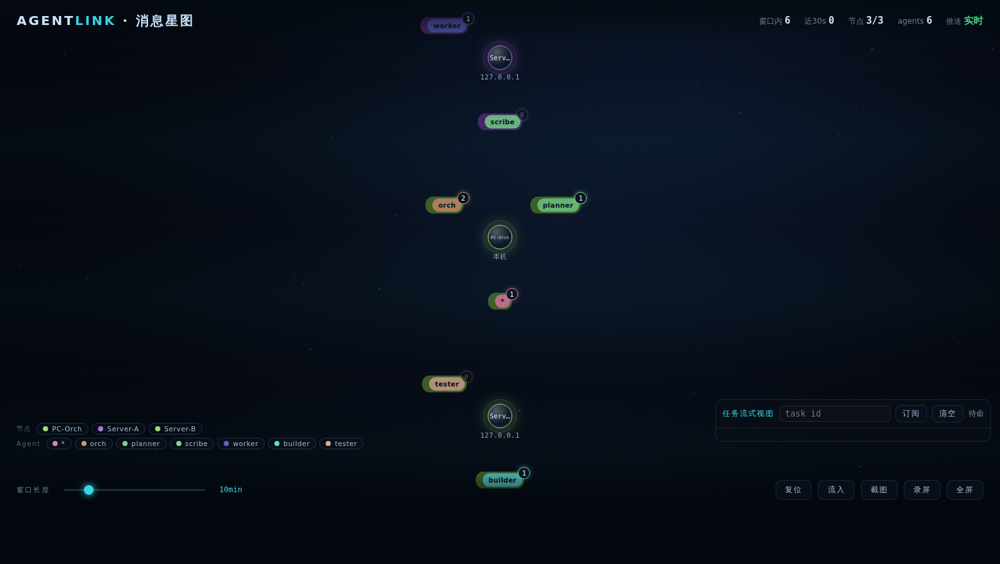

# AgentLink

**A tiny LAN message bus for AI agents.** Built for programs, not for human chat.

[English](README.md) · [简体中文](README.zh-CN.md)

   

<p align="center">
  
</p>

Each machine runs one small daemon (**node**). Agents on that machine talk to it over a local HTTP/WebSocket API; nodes auto-discover each other on the LAN and relay messages over a WebSocket mesh. One binary, zero runtime dependencies — pure Rust, no C toolchain, no external processes.

## Why

- **Agents on different machines can't talk.** SSH and shared folders are hacks; AgentLink gives them real addressing (`node_id` + `agent_id`), point-to-point and broadcast delivery, and a fleet-wide agent directory.
- **A daemon per machine, not per agent.** Many agents share one node; each registers with capability tags and receives only its own messages.
- **Reliability without infrastructure.** ACK + bounded retries + offline queue (TTL). No broker, no database, no Kubernetes.
- **Programs first.** A clean JSON envelope API and a live WebSocket subscription stream. A human-readable web console exists — but it is a window, not the product.

## Quick start (3 minutes)

```bash
# 1) Main machine — create a config (generates node_id + cluster token)
agentlink init --name PC-A

# 2) Other machines — one-command pairing, no file editing
agentlink join <cluster-token> --name PC-B

# 3) Run the node (foreground; deploy/ has systemd & Windows installers)
agentlink run
```

Send a message and watch it arrive on the peer:

```bash
curl -X POST http://127.0.0.1:8765/v1/send -H "X-Auth-Token: $TOKEN" -d \
  '{"to":"<node-id-of-PC-B>","to_agent":"worker","from_agent":"orch",
    "type":"text","action":"send","payload":{"content":"hello"}}'
```

Open `http://127.0.0.1:8765/web` for the live message starmap and console.
No config yet and a TTY attached? Just run `agentlink` — the setup wizard takes over.

## Features

| Area | What you get |
|---|---|
| Discovery | UDP broadcast (default) · mDNS (feature flag) · static peers (fallback) |
| Transport | Full-mesh WebSockets between nodes; dial direction decided by `node_id` order |
| Delivery | Point-to-point at-least-once (ACK, bounded retry, offline queue with TTL); broadcast at-most-once |
| Multi-agent | Per-machine agent registry with capability tags, synced fleet-wide (`/v1/fleet/agents`) |
| Files | Chunked transfer over a dedicated peer connection, SHA-256 verified, resumable, sandboxed to `recv_dir` |
| Security | `strict` mode: shared cluster token, HMAC handshake & frame signing, replay window; or `open` mode for trusted LANs |
| Observability | `/web` console with live starmap, `/v1/history`, event stream `/v1/events`, WS subscription `/v1/ws` |
| Ops | `agentlink hello` cluster self-check · `top` live overview · first-run wizard · autostart (systemd user unit / Windows scheduled task) · shell completions |
| Tasks | Task protocol (JSON envelope conventions) with a reference Python executor; the orchestration engine itself is commercial |

## Local API at a glance

| Method | Path | Auth | Purpose |
|---|---|---|---|
| GET | `/v1/health` | — | liveness probe |
| POST | `/v1/send` | token | send message (unicast or `"*"` broadcast) |
| POST | `/v1/send-file` | token | send a local file by path |
| GET/POST/DELETE | `/v1/agents` | token | register / list / unregister local agents |
| GET | `/v1/fleet/agents` | token | fleet-wide agent directory |
| GET | `/v1/history` | token | recent message history (ring buffer) |
| GET | `/v1/events` | token | observer event stream (redacted) |
| WS | `/v1/ws?token=…&client=…` | query token | subscribe to inbound messages addressed to your agent |
| GET | `/web` | in-page token | human console + live message starmap |

Full reference: [`docs/protocol.md`](docs/protocol.md) · [`docs/task-protocol.md`](docs/task-protocol.md) · [`docs/upgrade-protocol.md`](docs/upgrade-protocol.md)

## Architecture

```
┌──────────── machine A ────────────┐      ┌──────── machine B ────────┐
│  agent-1 ─┐                       │      │  ┌─ agent "worker"        │
│  agent-2 ─┤ HTTP/WS → node        │ WS   │  node ← HTTP/WS          │
│  agent-3 ─┘   :8765               │◄────►│   :8765                  │
│             :8766 UDP discovery   │ mesh │   UDP discovery / static │
└───────────────────────────────────┘      └──────────────────────────┘
```

- **Envelope**: one JSON shape for everything; `payload` passes through untouched.
- **Addressing**: `to` = `node_id` (12-hex) + `to_agent` = registered agent id. Same agent name on different machines is a feature; nodes disambiguate.
- **Ports**: `8765` local API + peer WS, `8766` UDP discovery. Open both in your firewall ([deploy guide](docs/部署.md)).

## Build from source

```bash
cargo build --release                    # → target/release/agentlink
cargo build --release --features mdns    # + mDNS discovery
```

Requires only a Rust toolchain (edition 2021). Linux, macOS and Windows are supported; the binary is ~6 MB stripped.

## Open source vs commercial

This repository is the **open-source core**: transport, delivery, files, security, console, CLI. The commercial edition layers task orchestration, RBAC, auditing and HA on top of this core. The core never depends on commercial code and builds standalone.

## Trademark

"AgentLink" is the project name and trademark. Do not use it to name or promote derivative products without written permission — see [`NOTICE`](NOTICE).

## License

Copyright 2026 The AgentLink Authors

Licensed under the Apache License, Version 2.0 ([LICENSE](LICENSE)).
